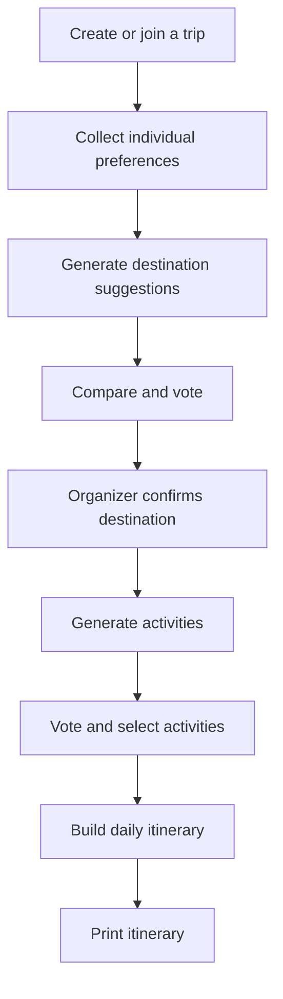
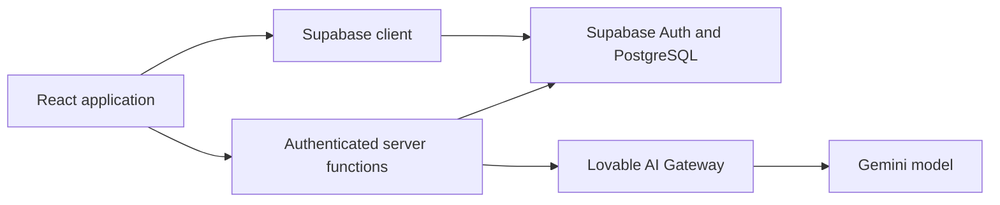
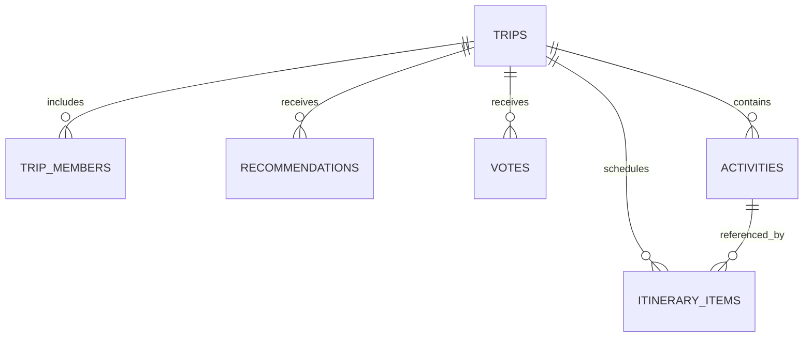

# TripSync — AI-Powered Group Travel Planner


**[Live application](https://acstripsync.lovable.app)**

## Overview

TripSync is a collaborative travel planning application that helps groups choose destinations, discover activities and build shared itineraries. It combines individual budgets and travel preferences with AI-generated suggestions and group voting, while leaving final decisions to the participants.

The application has a Romanian-language interface and uses EUR for estimated travel costs. It was developed with the assistance of [Lovable](https://lovable.dev).

## Engineering highlights

- Seven PostgreSQL tables with row-level security policies.
- Two authenticated server-side AI functions for destination and activity generation.
- Three database RPC functions for membership, organizer checks and joining trips.
- Four planning modules covering preferences, destinations, activities and itineraries.
- Group and individual compatibility scores generated by an LLM.
- Email/password authentication and invitation-code-based collaboration.
- A configurable trip duration of 1–30 days at the database level.

## Features

| Module | Functionality |
|---|---|
| Authentication | Registration, login, email confirmation flow and logout |
| Trip management | Create trips, set dates and duration, join through invitation codes |
| Preferences | Individual budget, beach, nature, culture, entertainment and travel pace |
| Destination discovery | AI-generated suggestions, estimated costs, group/member scores, comparisons and voting |
| Activities | AI-generated suggestions after destination confirmation, cost and duration filters, activity voting |
| Itinerary | Assign activities to days, reorder or move items, remove activities and review planned hours |
| Export | Browser-based printing of the itinerary |

## Planning workflow



The trip status progresses from organization to voting and then to destination confirmation (stored as finalized). Activities and itinerary planning follow destination confirmation.

## Technology stack

| Layer | Technologies |
|---|---|
| Application | React 19, TypeScript, TanStack Start, TanStack Router |
| Data fetching | TanStack Query, Supabase JS |
| UI | Tailwind CSS 4, Radix UI, shadcn-style components, Lucide |
| Backend | TanStack Start server functions, Supabase |
| Database | PostgreSQL, SQL migrations |
| Authentication | Supabase Auth, authenticated server middleware |
| AI | Lovable AI Gateway, google/gemini-3-flash-preview |
| Tooling | Vite, Bun lockfile, ESLint, Prettier |
| Testing | Vitest, Testing Library |

## System architecture



Regular data operations use the Supabase client under the user's session. AI requests are handled server-side, with authentication middleware validating bearer tokens and providing a user-scoped database client. AI credentials are read from server environment variables rather than embedded in browser code.

## Database design



| Table | Responsibility |
|---|---|
| profiles | User display names linked to authenticated accounts |
| trips | Trip metadata, organizer, invitation code, status and selected destination |
| trip_members | Membership, role and individual preferences |
| recommendations | AI destination suggestions, cost estimates and compatibility scores |
| votes | Member votes for destinations or activities |
| activities | Suggested activities, category, duration and estimated cost |
| itinerary_items | Activity assignments, day and ordering position |

The migration defines row-level security policies for authenticated users, membership checks and organizer permissions. Triggers create profiles and organizer memberships automatically. The generated Supabase types describe the database interface; the Drizzle schema file itself is intentionally empty.

## AI integration

The application exposes two authenticated TanStack Start server functions:

| Function | Purpose |
|---|---|
| generateDestinations | Loads completed preferences, requests destination suggestions and persists recommendations |
| generateActivities | Loads the confirmed destination and preferences, requests activity suggestions and persists results |

Destination generation requests four options and accepts up to six returned suggestions. Each suggestion includes a group compatibility score, member-level scores, an estimated cost and a short explanation of trade-offs.

Activity generation requests up to 24 suggestions based on trip duration, with category, estimated cost and duration.

Responses are requested as JSON, parsed and mapped into database records. The integration handles invalid JSON, unavailable service responses, rate limiting and exhausted AI credits.

**AI limitations:** Scores and costs are model-generated estimates, not verified optimization results or live prices. Suggestions should be checked before making travel arrangements.

## Engineering decisions

- **Human-in-the-loop planning:** AI proposes options; members vote and the organizer confirms the destination.
- **Relational persistence:** Separate tables model group membership, preferences, votes and itinerary assignments.
- **Access control:** Database policies complement frontend route protection and authenticated AI functions.
- **Server-side AI calls:** Provider credentials remain on the server.
- **Planning constraints:** The UI checks a 10-hour daily activity limit when adding activities. This is not a database-enforced invariant.
- **Typed data access:** Generated Supabase types support compile-time checks for application queries.

## Project structure

```text
acstripsync/
├── drizzle/
│   └── migrations/
│       └── 0000_migration.sql
├── src/
│   ├── components/ui/
│   ├── integrations/supabase/
│   ├── lib/
│   │   ├── ai.functions.ts
│   │   └── trip.ts
│   ├── routes/
│   │   ├── _authenticated/
│   │   │   ├── dashboard.tsx
│   │   │   ├── route.tsx
│   │   │   └── trips.$id.tsx
│   │   ├── auth.tsx
│   │   └── index.tsx
│   ├── test/
│   ├── server.ts
│   └── start.ts
├── supabase/
├── package.json
└── README.md
```

## Getting started

### Prerequisites

- Git and a Node.js version compatible with Vite 8 (Node.js 22.12+ recommended).
- Bun (recommended for the committed lockfile).
- A Supabase project with email/password authentication configured.
- Access to the Lovable AI Gateway for AI-powered features.

### Install dependencies

```bash
git clone https://github.com/Claudio1009/acstripsync.git
cd acstripsync
bun install
```

### Configure services

For an independent development environment, provision a Supabase project and apply the SQL in `drizzle/migrations/0000_migration.sql` once to a fresh compatible database. Configure the authentication site URL and allowed redirects for your local environment.

Create or configure local environment variables using your own project values:

```dotenv
VITE_SUPABASE_URL=https://your-project.supabase.co
VITE_SUPABASE_PUBLISHABLE_KEY=your_publishable_key
SUPABASE_URL=https://your-project.supabase.co
SUPABASE_PUBLISHABLE_KEY=your_publishable_key
LOVABLE_API_KEY=your_server_side_ai_key
```

Use the corresponding server runtime secret configuration if environment variables are not loaded automatically. Never put AI keys or service-role credentials in VITE-prefixed variables. Do not commit private credentials.

The hosted Lovable environment may provision these integrations automatically. Independent setup requires compatible service access and has not been verified here.

### Run locally

```bash
bun run dev
```

Open the URL printed by Vite.

## Testing and code quality

```bash
bun run test
bun run lint
bun run build
```

The repository includes a routing smoke test using Vitest. A passing build, full end-to-end coverage and production readiness are not asserted.

## Limitations and future improvements

- Validate AI output against explicit schemas, including score ranges, durations and required fields.
- Avoid sending unnecessary personal identifiers to the AI provider.
- Enforce daily itinerary limits and cross-trip references at the database level.
- Make destination vote replacement atomic.
- Add AI request quotas, deduplication and stronger authorization checks for generation actions.
- Expand integration tests for RLS, voting, scheduling and AI error handling.
- Add verified travel pricing and availability sources if required.
- Improve invitation-code abuse protection and review profile visibility.
- Document and verify independent deployment and environment configuration.

## Project context

Built with [Lovable](https://lovable.dev). The existing project can also be opened in the [Lovable editor](https://lovable.dev/projects/5fd892a2-0f3d-4ef8-9fc8-5f8b88cda2fb).

This README documents the implementation present in the repository and distinguishes existing functionality from proposed improvements.
